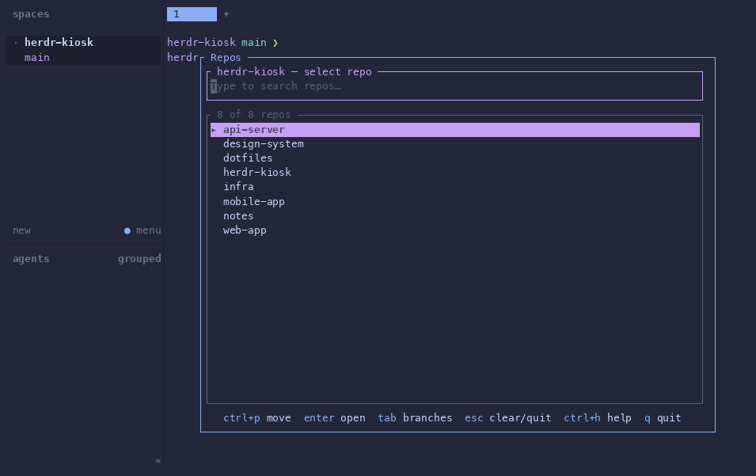

# herdr-kiosk

Fuzzy-find Git repositories (or any folder) and branches, then open them as Herdr
workspaces and worktrees. It runs in both the herdr TUI (as a plugin) and the Herdr
desktop app (as a mod), from the same binary.



## Install in the herdr TUI

Install from GitHub:

```sh
herdr plugin install thomasschafer/herdr-kiosk
```

Add a keybinding to open the picker (here, `prefix+f`):

```toml
[[keys.command]]
key = "prefix+f"
type = "plugin_action"
command = "thomasschafer.herdr-kiosk.open-picker"
description = "open repo picker"
```

Then reload Herdr's configuration:

```sh
herdr server reload-config
```

On first use, a setup wizard writes the directories and scan depth to the plugin's
`config.toml`. Locate it with:

```sh
herdr plugin config-dir thomasschafer.herdr-kiosk
```

At the time of writing, Herdr has no plugin-update command. Reinstall the plugin
from GitHub to update to a newer version.

## Install in the Herdr app

The app runs kiosk from a checkout of this repository, through the mod in
[`herdr-app/kiosk`](herdr-app/kiosk). The mod supports macOS and Linux. Build the binary, then link the mod folder into
the app's `mods/` as `kiosk` (the mod finds the binary through that link, at
`target/release/herdr-kiosk` in the same checkout):

```sh
git clone https://github.com/thomasschafer/herdr-kiosk.git
cd herdr-kiosk
cargo build --release
ln -s "$PWD/herdr-app/kiosk" ~/.config/herdr-app/mods/kiosk
herdr-app check ~/.config/herdr-app/mods/kiosk
```

Bind a key to open it in `~/.config/herdr-app/keys.json`:

```json
{ "global": { "cmd-p": "mod.open:kiosk" } }
```

On macOS this takes `cmd-p` from the app's own tab picker.

Kiosk opens in a large dialog over the window and closes when it exits. Its
configuration lives in `~/.config/herdr-kiosk/config.toml` (or under
`$XDG_CONFIG_HOME`), and the setup wizard writes it on first use. To update,
pull the checkout and rebuild.

In the app, a workspace is a space: opening a repository makes an unnamed space in it,
which the app names after its folder, and selects the existing space when one is already
there. A space shows a checkout when its first terminal's folder is inside it. New
worktrees go in `~/.herdr/worktrees/<repo>/<branch>`, the same place as the herdr TUI's
default and the app's own worktree menu, and the app's sidebar nests them under their
repository. `[on_open]` panes split the new space's first pane with their command typed
into the new shell as it starts, so it runs as soon as the shell is ready and the shell
stays when it ends; the app always splits in half, so a pane with a `ratio` is refused
with a notification.

## Usage

Type to fuzzy-search repositories and branches (and plain folders, if you enable
`include_non_git`). `enter` opens the selected checkout or folder, `tab` opens a
repository's branch view (for Git repositories), and `ctrl+h` shows all active bindings
for the current view.

## Configuration

<!-- CONFIG:START -->
In the herdr TUI, the plugin reads `config.toml` from its config directory: run
`herdr plugin config-dir thomasschafer.herdr-kiosk` to locate it. In the Herdr
app, kiosk reads `$XDG_CONFIG_HOME/herdr-kiosk/config.toml`, which is
`~/.config/herdr-kiosk/config.toml` when `XDG_CONFIG_HOME` is unset. All sections are optional, and the defaults are shown below alongside curated
examples for settings that benefit from one.

#### `search_dirs`

Directories searched recursively for Git repositories and, when enabled,
plain folders. Entries can be simple strings such as `"~/Code"` or inline
tables such as `{ path = "~/Work", depth = 3 }`, and both forms can be mixed.
Missing directories are reported as warnings unless marked `optional`.

Example:

```toml
include_non_git = false
search_dirs = [
  "~/Code",
  { path = "~/Work", depth = 2, include_non_git = true },
  { path = "~/Clients", optional = true },
]
```

A repository search root, written either as a path string or an inline table.

Accepted forms:

- String form.
  - Directory to scan with the default depth of 1. `~` and paths beginning with `~/` expand from the user's home directory.
- A path with optional per-directory scan depth, plain-folder override, and missing-directory tolerance.
  - `path` — Directory to scan. `~` and paths beginning with `~/` expand from the user's home directory; other relative paths are accepted as written.
  - `depth` — Maximum directory depth to scan. The value must be at least 1 and defaults to 1 when omitted.
  - `include_non_git` — Whether to include plain folders for this search root. When omitted, the global `include_non_git` value is used.
  - `optional` — Whether this directory may be absent. A missing optional directory is skipped without a warning; a path that exists but is not a readable directory still warns. Defaults to `false`.

#### `include_non_git`

Include plain folders in search results globally. Rich search-directory
entries can override this value with their own `include_non_git` setting.

Default: `false`

### `[theme]`

Customize terminal-palette colors used by the picker. Light-terminal users
can set `muted`, `border`, and other colors explicitly.

Colors use the terminal's ANSI palette and can be `black`, `red`, `green`, `yellow`, `blue`, `magenta`, `cyan`, `white`, `gray`, `dark_gray`, `reset`.

Defaults:

```toml
[theme]
accent = "magenta"
secondary = "cyan"
tertiary = "green"
error = "red"
warning = "yellow"
muted = "dark_gray"
border = "dark_gray"
hint = "blue"
highlight_fg = "black"
open = "green"
```

### `[on_open]`

Configure command panes created after opening a new workspace.

The section is optional and contains no pane definitions by default.

Example:

```toml
[on_open]
panes = [
  { command = "hx", direction = "right" },
]
```

#### `panes`

Pane definitions, created in order without moving focus from the primary
pane. Commands run from the opened repository or worktree. They run only
when a workspace is newly opened, not when an existing workspace is focused.

A command pane created after a new workspace is opened.

Each entry is an inline table with:

- `command` — Shell command Herdr runs in the opened checkout. The command must not be empty.
- `direction` — Split direction: `right` or `down`.
- `ratio` — Fraction of the resulting split occupied by the new command pane. The value must be greater than 0 and less than 1, and defaults to 0.5 when omitted. The Herdr app always splits in half, so it refuses a pane with a ratio.

### `[keys]`

Customize key bindings grouped by where they are active.

Assign a key to `"noop"` to unbind an inherited mapping.

Write chords with lowercase `ctrl+`, `alt+`, and `shift+` modifiers followed by a character or a named key such as `enter`, `esc`, `tab`, `backspace`, `delete`, an arrow, `home`, `end`, `pageup`, `pagedown`, or `space`.

Defaults:

```toml
[keys.general]
"ctrl+c" = "quit"
"ctrl+e" = "scan_warnings"
"ctrl+h" = "help"
"ctrl+x" = "dismiss_toast"

[keys.text_edit]
"alt+backspace" = "delete_word"
"backspace" = "backspace"
"ctrl+w" = "delete_word"
"esc" = "clear"
"left" = "cursor_left"
"right" = "cursor_right"

[keys.list_navigation]
"ctrl+n" = "move_down"
"ctrl+p" = "move_up"
"down" = "move_down"
"up" = "move_up"

[keys.modal]
"enter" = "open"
"esc" = "back"

[keys.repo_select]
"enter" = "open"
"q" = "quit"
"tab" = "branches_view"

[keys.branch_select]
"ctrl+o" = "new_branch"
"ctrl+x" = "delete"
"enter" = "open"
"esc" = "back"

```

<!-- CONFIG:END -->

## Windows support

Windows is supported and uses PowerShell launch shims plus a native
`x86_64-pc-windows-msvc` binary. Installation downloads and verifies that prebuilt,
with Cargo used only as a fallback.

## Development

Build before linking because `herdr plugin link` does not run `[[build]]` commands:

```sh
cargo build --release
herdr plugin link .
```

`just link` combines these steps. For the Herdr app, `cargo build --release` is
enough once the mod folder is linked: the app reloads the mod by itself, and kiosk
starts fresh each time it opens. `just e2e` runs the popup integration suite; it
uses a built Herdr checkout next to this repository unless `HERDR` points elsewhere.
Harness and manual-testing details are in
[`docs/VERIFYING.md`](docs/VERIFYING.md).
