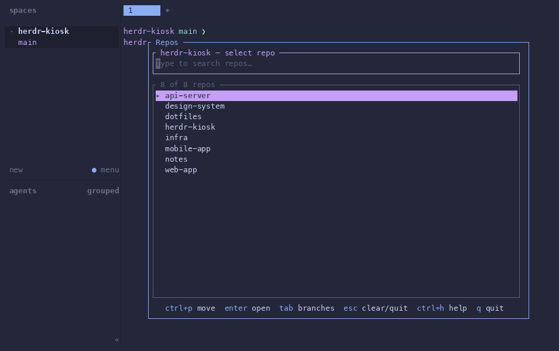

# herdr-kiosk

Fuzzy-find Git repositories (or any folder) and branches, then open them as Herdr
workspaces and worktrees, as a plugin for the herdr TUI.



## Install in the herdr TUI

Install from GitHub:

```sh
herdr plugin install thomasschafer/herdr-kiosk
```

The install fetches the release's prebuilt binary for your platform and checks it against
the release's `SHA256SUMS` and, if the [GitHub CLI](https://cli.github.com) is installed and
logged in, its build attestation, which shows that this repository's release workflow built
it. It stops if the attestation doesn't check out; set `KIOSK_SKIP_ATTESTATION=1` to rely on the
checksum alone. Where there is no prebuilt binary, or it doesn't match its checksum, the
install builds from source, which needs Rust.

Add a keybinding to open the picker (here, `prefix+f`):

```toml
[[keys.command]]
key = "prefix+f"
type = "plugin_action"
command = "thomasschafer.herdr-kiosk.open-picker"
description = "open repo picker"
```

Then reload Herdr's configuration:

```sh
herdr server reload-config
```

On first use, a setup wizard writes the directories and scan depth to the plugin's
`config.toml`. Locate it with:

```sh
herdr plugin config-dir thomasschafer.herdr-kiosk
```

At the time of writing, Herdr has no plugin-update command. Reinstall the plugin
from GitHub to update to a newer version.

## The Herdr desktop app

For the Herdr desktop app, use
[herdr-app-kiosk](https://github.com/thomasschafer/herdr-app-kiosk), a mod in the app's
gallery; its README covers installing it.

## Usage

Type to fuzzy-search repositories and branches (and plain folders, if you enable
`include_non_git`). `enter` opens the selected checkout or folder, `tab` opens a
repository's branch view (for Git repositories), and `esc` goes back, or closes the picker
from the repository list. `ctrl+u` clears the search, which edits like a shell prompt
(`alt+b` and `alt+f` move by word, `ctrl+a` and `ctrl+e` to either end), and `ctrl+h` (or
`f1`) shows all active bindings for the current view.

## Configuration

<!-- CONFIG:START -->
The plugin reads `config.toml` from its config directory: run
`herdr plugin config-dir thomasschafer.herdr-kiosk` to locate it. All sections are
optional, and the defaults are shown below alongside curated examples for settings
that benefit from one.

#### `search_dirs`

Directories searched recursively for Git repositories and, when enabled,
plain folders. Entries can be simple strings such as `"~/Code"` or inline
tables such as `{ path = "~/Work", depth = 3 }`, and both forms can be mixed.
Missing directories are reported as warnings unless marked `optional`.

Example:

```toml
include_non_git = false
search_dirs = [
  "~/Code",
  { path = "~/Work", depth = 2, include_non_git = true },
  { path = "~/Clients", optional = true },
]
```

A repository search root, written either as a path string or an inline table.

Accepted forms:

- String form.
  - Directory to scan with the default depth of 1. `~` and paths beginning with `~/` expand from the user's home directory.
- A path with optional per-directory scan depth, plain-folder override, and missing-directory tolerance.
  - `path` — Directory to scan. `~` and paths beginning with `~/` expand from the user's home directory; other relative paths are accepted as written.
  - `depth` — Maximum directory depth to scan. The value must be at least 1 and defaults to 1 when omitted.
  - `include_non_git` — Whether to include plain folders for this search root. When omitted, the global `include_non_git` value is used.
  - `optional` — Whether this directory may be absent. A missing optional directory is skipped without a warning; a path that exists but is not a readable directory still warns. Defaults to `false`.

#### `include_non_git`

Include plain folders in search results globally. Rich search-directory
entries can override this value with their own `include_non_git` setting.

Default: `false`

### `[theme]`

Customize terminal-palette colors used by the picker. Light-terminal users
can set `muted`, `border`, and other colors explicitly.

Colors use the terminal's ANSI palette and can be `black`, `red`, `green`, `yellow`, `blue`, `magenta`, `cyan`, `white`, `gray`, `dark_gray`, `reset`.

Defaults:

```toml
[theme]
accent = "magenta"
secondary = "cyan"
tertiary = "green"
error = "red"
warning = "yellow"
muted = "dark_gray"
border = "dark_gray"
hint = "blue"
highlight_fg = "black"
open = "green"
```

### `[on_open]`

Configure command panes created after opening a new workspace.

The section is optional and contains no pane definitions by default.

Example:

```toml
[on_open]
panes = [
  { command = "hx", direction = "right" },
]
```

#### `panes`

Pane definitions, created in order without moving focus from the primary
pane. Commands run from the opened repository or worktree. They run only
when a workspace is newly opened, not when an existing workspace is focused.

A command pane created after a new workspace is opened.

Each entry is an inline table with:

- `command` — Shell command Herdr runs in the opened checkout. The command must not be empty.
- `direction` — Split direction: `right` or `down`.
- `ratio` — Fraction of the resulting split occupied by the new command pane. The value must be greater than 0 and less than 1, and defaults to 0.5 when omitted.

### `[keys]`

Customize key bindings grouped by where they are active.

Assign a key to `"noop"` to unbind an inherited mapping.

Write chords with lowercase `ctrl+`, `alt+`, and `shift+` modifiers followed by a character or a named key such as `enter`, `esc`, `tab`, `backspace`, `delete`, an arrow, `home`, `end`, `pageup`, `pagedown`, or `space`.

Each section accepts these actions:

- `[keys.general]`: `noop`, `quit`, `help`, `dismiss_toast`, `scan_warnings`
- `[keys.text_edit]`: `noop`, `clear`, `backspace`, `delete_forward`, `delete_word`, `delete_word_forward`, `delete_to_end`, `cursor_left`, `cursor_right`, `cursor_word_left`, `cursor_word_right`, `cursor_start`, `cursor_end`
- `[keys.list_navigation]`: `noop`, `move_up`, `move_down`
- `[keys.modal]`: `noop`, `open`, `back`
- `[keys.repo_select]`: `noop`, `open`, `branches_view`, `quit`
- `[keys.branch_select]`: `noop`, `open`, `back`, `new_branch`, `delete`, `backspace`, `backspace_or_back`

What each action does:

- `noop` — Unbound
- `quit` — Quit the picker
- `help` — Show active key bindings
- `dismiss_toast` — Dismiss the visible notification
- `scan_warnings` — Show directories that could not be scanned
- `clear` — Clear the search query
- `backspace` — Delete the previous character
- `delete_forward` — Delete the next character
- `delete_word` — Delete the previous word
- `delete_word_forward` — Delete the next word
- `delete_to_end` — Delete to the end
- `cursor_left` — Move the cursor left
- `cursor_right` — Move the cursor right
- `cursor_word_left` — Move the cursor back a word
- `cursor_word_right` — Move the cursor forward a word
- `cursor_start` — Move the cursor to the start
- `cursor_end` — Move the cursor to the end
- `move_up` — Move selection up
- `move_down` — Move selection down
- `open` — Open or confirm the selection
- `back` — Go back or cancel
- `branches_view` — Browse repository branches
- `new_branch` — Create a new branch
- `delete` — Delete the selected checkout
- `backspace_or_back` — Delete the previous character, or go back when the search is empty

Defaults:

```toml
[keys.general]
"ctrl+c" = "quit"
"ctrl+h" = "help"
"ctrl+s" = "scan_warnings"
"f1" = "help"

[keys.text_edit]
"alt+b" = "cursor_word_left"
"alt+backspace" = "delete_word"
"alt+d" = "delete_word_forward"
"alt+delete" = "delete_word_forward"
"alt+f" = "cursor_word_right"
"alt+left" = "cursor_word_left"
"alt+right" = "cursor_word_right"
"backspace" = "backspace"
"ctrl+a" = "cursor_start"
"ctrl+b" = "cursor_left"
"ctrl+d" = "delete_forward"
"ctrl+e" = "cursor_end"
"ctrl+f" = "cursor_right"
"ctrl+k" = "delete_to_end"
"ctrl+left" = "cursor_word_left"
"ctrl+right" = "cursor_word_right"
"ctrl+u" = "clear"
"ctrl+w" = "delete_word"
"delete" = "delete_forward"
"end" = "cursor_end"
"home" = "cursor_start"
"left" = "cursor_left"
"right" = "cursor_right"

[keys.list_navigation]
"ctrl+n" = "move_down"
"ctrl+p" = "move_up"
"down" = "move_down"
"up" = "move_up"

[keys.modal]
"enter" = "open"
"esc" = "back"

[keys.repo_select]
"enter" = "open"
"esc" = "quit"
"tab" = "branches_view"

[keys.branch_select]
"ctrl+o" = "new_branch"
"ctrl+x" = "delete"
"enter" = "open"
"esc" = "back"

```

<!-- CONFIG:END -->

## Windows support

Windows is supported and uses PowerShell launch shims plus a native
`x86_64-pc-windows-msvc` binary. Installation downloads and verifies that prebuilt,
with Cargo used only as a fallback.

## Development

Build before linking because `herdr plugin link` does not run `[[build]]` commands:

```sh
cargo build --release
herdr plugin link .
```

`just link` combines these steps. `just e2e` runs the popup integration suite; it
uses a built Herdr checkout next to this repository unless `HERDR` points elsewhere,
and tmux from `PATH` unless `HK_TMUX` does. It runs everything, Herdr's server
included, in a sandbox under `/tmp/hk-m7` (or `HK_E2E_HOME`).
Harness and manual-testing details are in
[`docs/VERIFYING.md`](docs/VERIFYING.md).
